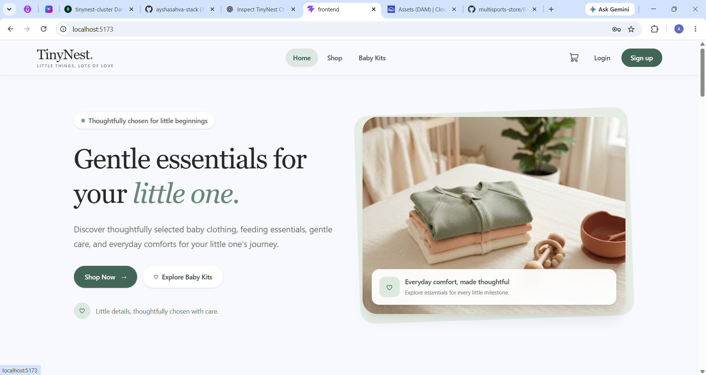
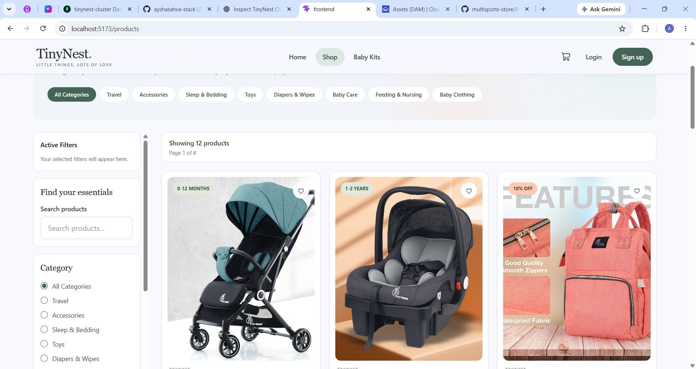
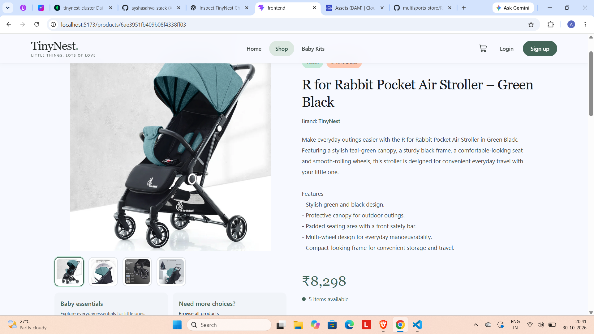
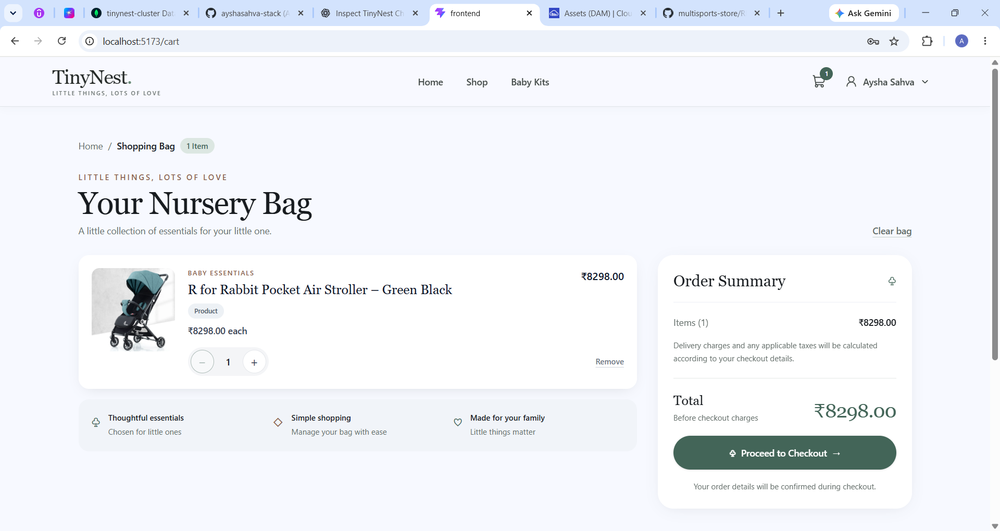
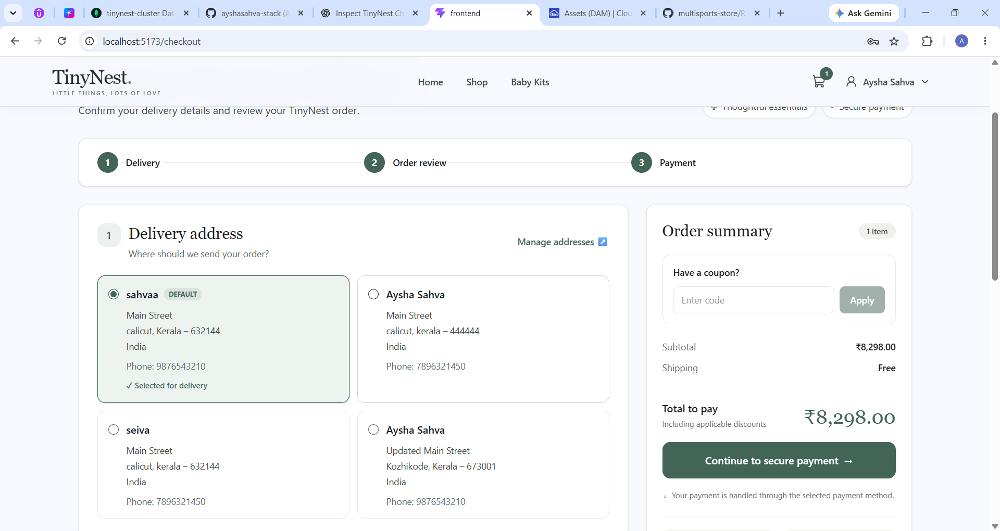
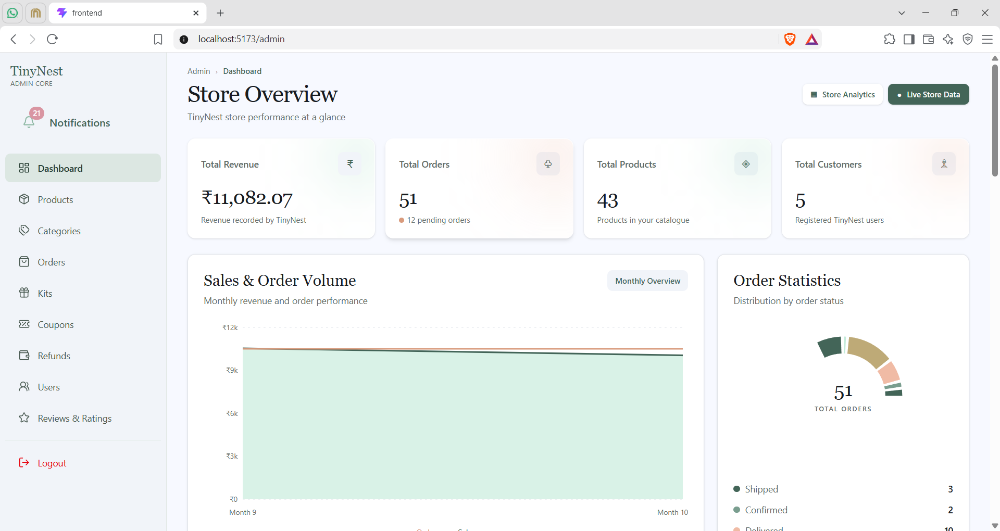

# TinyNest – Baby Essentials E-Commerce

TinyNest is a full-stack MERN e-commerce application for shopping baby essentials. It provides customers with a simple shopping experience and includes an admin area for managing the store.

## 📸 Screenshots

### Home Page


### Products


### Product Details


### Shopping Cart


### Checkout


### Admin Dashboard


## ✨ Features

### Customer
- User registration and login
- Email OTP verification
- Forgot password and password reset
- Browse products and view product details
- Shopping cart and wishlist
- Baby kits
- Address management
- Coupon application during checkout
- Razorpay payment integration
- Order history and order details
- Refund management
- Light and dark theme

### Admin
- Admin dashboard and store overview
- Product management
- Category management
- Baby kit management
- Coupon management
- Order management
- Refund management
- User management
- Product image uploads using Cloudinary

## 🧰 Tech Stack

### Frontend
- React.js
- Vite
- React Router
- Redux Toolkit
- Tailwind CSS
- Bootstrap
- Axios
- React Hook Form
- Yup

### Backend
- Node.js
- Express.js
- MongoDB
- Mongoose
- JWT authentication
- bcrypt
- Nodemailer
- Multer
- Cloudinary
- Razorpay

## 📁 Project Structure

The following is a simplified overview. Update it if your actual folder names differ.

```text
TinyNest/
├── backend/
│   └── src/
│       ├── config/
│       ├── controllers/
│       ├── middleware/
│       ├── models/
│       ├── routes/
│       ├── utils/
│       └── validations/
├── frontend/
│   └── src/
│       ├── assets/
│       ├── components/
│       ├── context/
│       ├── pages/
│       ├── redux/
│       ├── services/
│       └── validations/
├── screenshots/
└── README.md
```

## ⚙️ Getting Started

### Prerequisites
- Node.js and npm
- MongoDB Atlas account (or a MongoDB instance)
- Cloudinary account
- Razorpay account for payment testing
- Email account configured for application email delivery

### 1. Clone the repository

```bash
git clone YOUR_GITHUB_REPOSITORY_URL
cd TinyNest
```

### 2. Install dependencies

Install backend dependencies:

```bash
cd backend
npm install
```

Install frontend dependencies:

```bash
cd ../frontend
npm install
```

### 3. Configure environment variables

Create the backend `.env` file and provide the variables used by your backend configuration. Example names:

```env
PORT=5000
MONGO_URI=your_mongodb_connection_string
JWT_SECRET=your_jwt_secret

EMAIL_USER=your_email_address
EMAIL_PASS=your_email_app_password

CLOUDINARY_CLOUD_NAME=your_cloud_name
CLOUDINARY_API_KEY=your_cloudinary_api_key
CLOUDINARY_API_SECRET=your_cloudinary_api_secret

RAZORPAY_KEY_ID=your_razorpay_key_id
RAZORPAY_KEY_SECRET=your_razorpay_key_secret
```

If your frontend reads the API base URL from an environment variable, create the frontend `.env` file too. For example:

```env
VITE_API_URL=http://localhost:5000/api
```

**Important:** These are example variable names. Use the exact names and API URL expected by your source code. Never commit real credentials or `.env` files to GitHub.

### 4. Run the application

Start the backend using the development script defined in `backend/package.json`.

Start the frontend using the script defined in `frontend/package.json`. For a typical Vite setup:

```bash
npm run dev
```

Open the local URL printed by Vite in your browser.

## 🔒 Security Notes

- Keep `.env` files out of version control.
- Configure production CORS to allow only your frontend domain.
- Use test credentials while testing Razorpay.
- Do not expose secret keys in frontend code.
- Restrict admin routes and APIs to authorized admin users.

## 🎨 Design

TinyNest uses a soft sage-green visual identity, clean layouts, and a responsive shopping interface designed around baby and family essentials.

## 👩‍💻 Developer

**Aysha Sahva K**

MERN Stack Development

---

*Built as a full-stack learning and portfolio project.*
